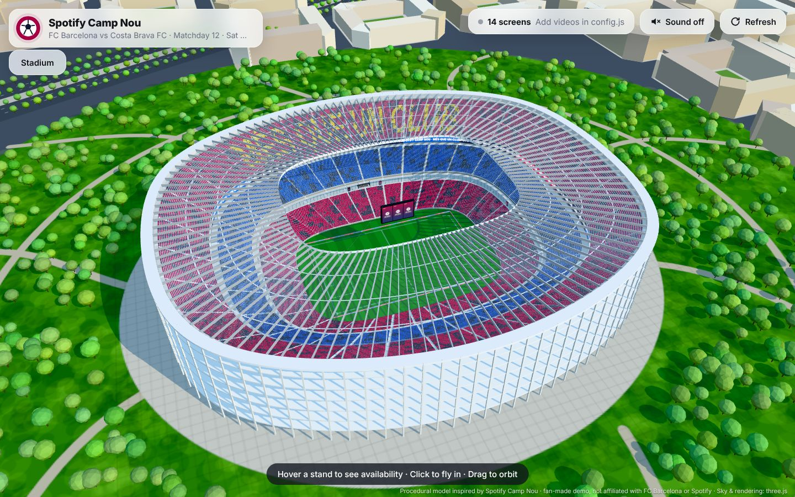

# Spotify Camp Nou: 3D seat picker

A 3D seat picker for Spotify Camp Nou that runs in the browser. Fans fly from an aerial view of the stadium into a stand, then a block, then their exact seat. They see the real view from that seat before they confirm a ticket.

It follows the build steps in [`../matchday-arena-showcase`](../matchday-arena-showcase), but uses Camp Nou instead of the stadium in that showcase. This is a fan-made demo. It is not affiliated with FC Barcelona or Spotify.



## Run it

You need [Node.js](https://nodejs.org) 18 or newer. There is nothing to install.

```bash
cd camp-nou-arena
```

```bash
npm start
```

Then open **http://localhost:5173**.

| URL option | What it does |
|---|---|
| `?mobile` / `?desktop` | Force the phone or laptop experience |
| `?hq` | High quality on strong GPUs: 4K soft shadows, clear-coat seats, all 14 screens live |

## What's in it

- **Stadium:** Camp Nou's oval bowl with three steep tiers, the VIP ring, a 360° LED ribbon, the stacked exterior terraces and the ring roof. It's surrounded by Barcelona: Eixample city blocks, Av. Diagonal and a park.
- **About 90,000 seats** in 96 blocks (32 sectors × 3 tiers) across Tribuna, Lateral, Gol Nord and Gol Sud. Seats use the club colours, and **MÉS QUE UN CLUB** is spelled out in yellow seats on the Lateral upper tier. About 30% of seats are marked as taken, shown in dark grey.
- **The flow:** aerial view → stand → block (rounded high-detail seats) → seat with a ticket and a rendered "Your view" picture → optional skybox upgrade → first-person view from the seat → confirm, with a ticket and QR code. You can step back at any point with the back button, the breadcrumbs or Esc.
- **Laptop vs phone:** on a laptop you hover to preview and click to choose. On a phone you tap to preview and tap again to choose, and you pinch to zoom. Phones also get solid panels, safe-area insets and their own quality preset.
- **Smoothness:** the scene only redraws when something changes. Shadows are cached (one shadow map per camera flight), shaders are compiled during the preloader, and resolution adjusts dynamically based on the device's frame cadence. It also redraws after a resize, a tab switch or a GPU context loss.
- **Extras:** a bouncing-football preloader, a Refresh button, and a colour grade built into the tone-mapping shader.

## Live screens

The 14 screens (two centre-hung boards plus eight on the VIP ring) can play YouTube Shorts. Add video IDs to `PLAYLISTS` in [`js/config.js`](js/config.js). Until you do, the screens show a branded placeholder.

## Using the Sketchfab Camp Nou model

1. Download the model from Sketchfab (you need a free account). Pick the **glTF Binary (.glb)** format and check the model's licence.
2. Save it as `assets/camp-nou.glb`.
3. Reload the page. The model is scaled automatically to fit the bowl, and it replaces the procedural façade and roof.

If the model doesn't line up, adjust `MODEL.scale`, `MODEL.rotationY` and `MODEL.offset` in `js/config.js`. The seat picker still uses its own seats, terraces and pitch, because those are what make seats clickable. If the model includes its own seats, you'll see two sets of seats until you line them up or hide the model's seats.

## Files

| Path | What |
|---|---|
| `index.html`, `styles.css` | Page, UI and preloader |
| `js/config.js` | Names, fixture, colours, video playlists, optional model |
| `js/layout.js` | Bowl geometry maths and the seat layout |
| `js/stadium.js` | Tiers, roof, façade, pitch, skyboxes |
| `js/seats.js` | Instanced seats, highlighting, high-detail block |
| `js/world.js` | Sky, sun, colour grade, Barcelona around the stadium |
| `js/screens.js` | Live YouTube screens in 3D |
| `js/main.js` | Flow, camera flights, picking, render loop |
| `vendor/three` | three.js r180 (MIT), bundled so the site runs offline |
| `server.js` | Small static server with no dependencies |
