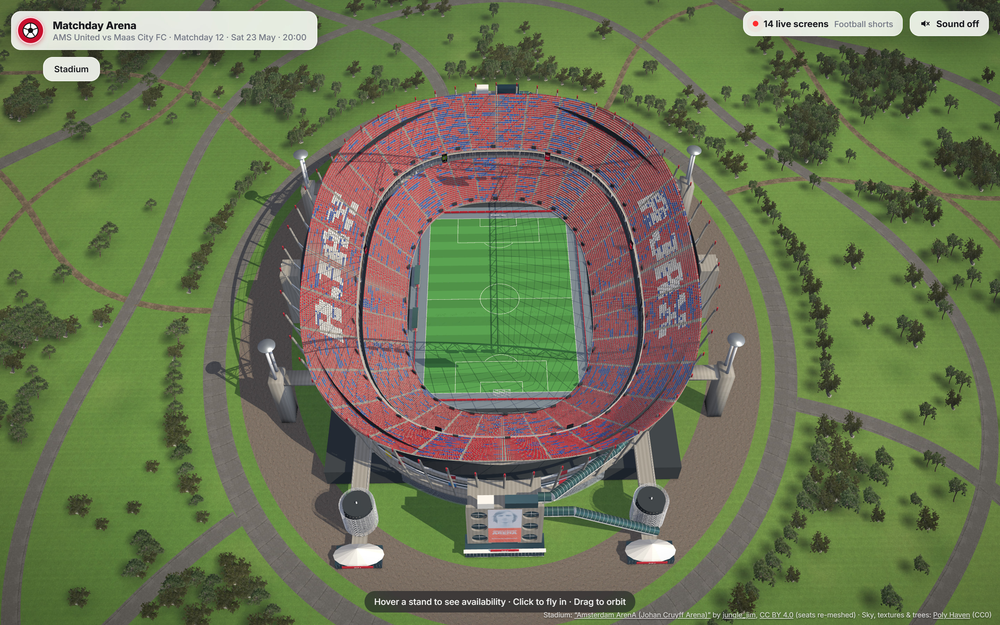
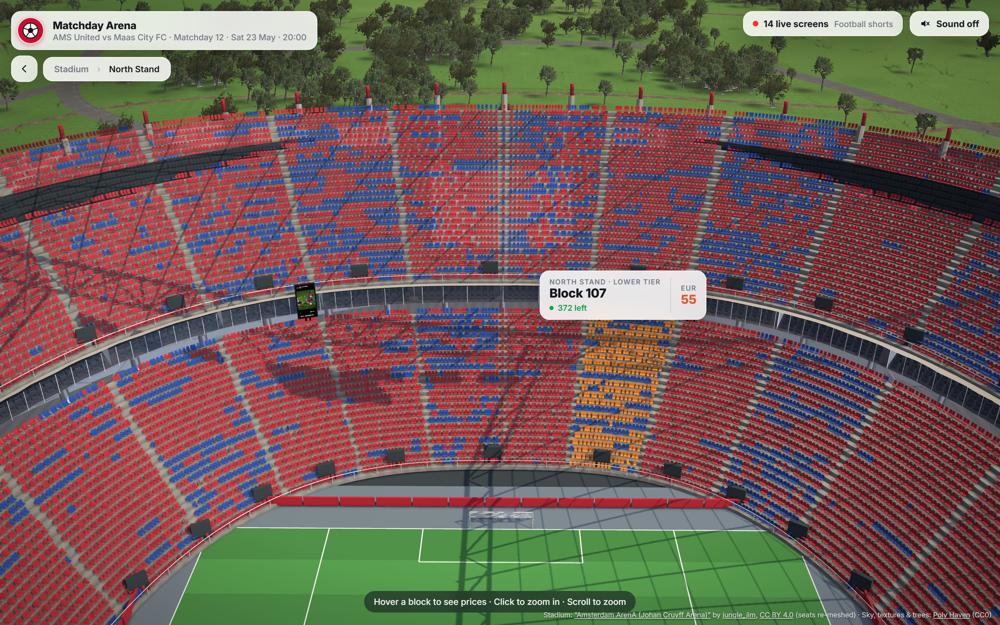
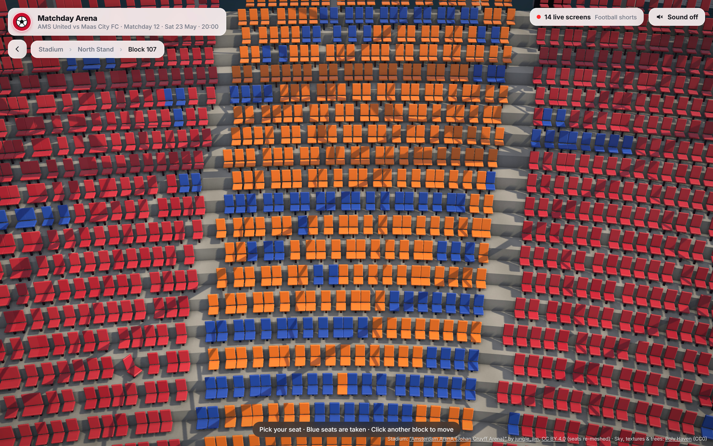
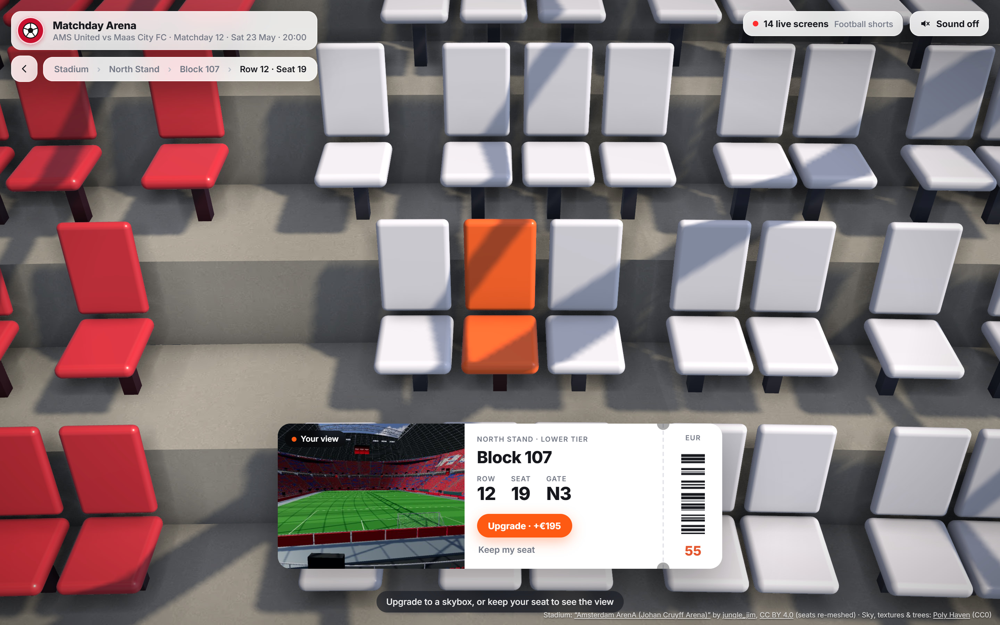
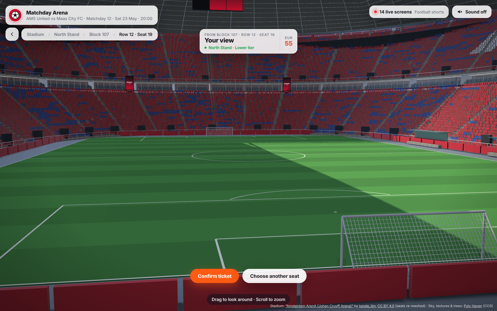
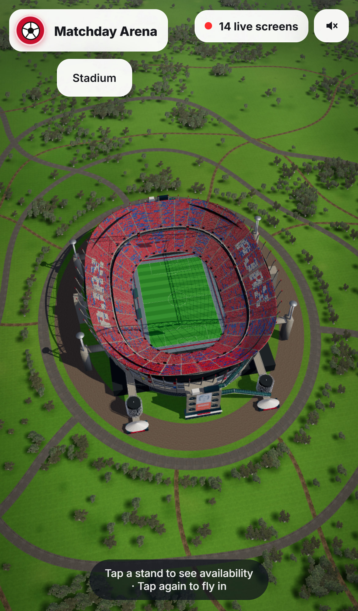
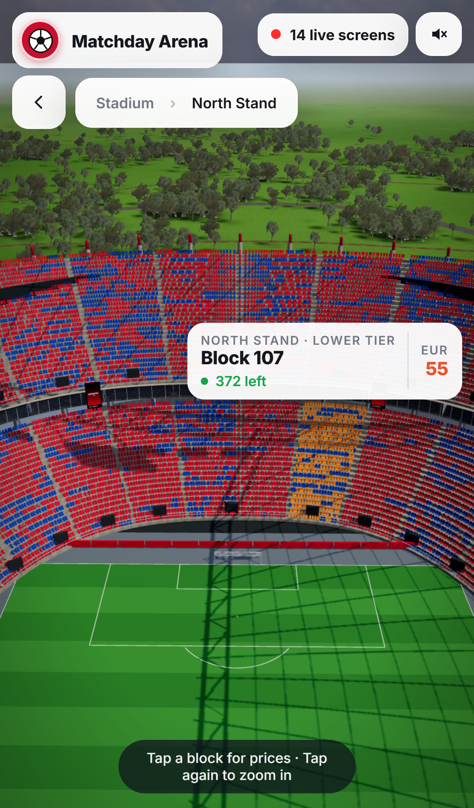
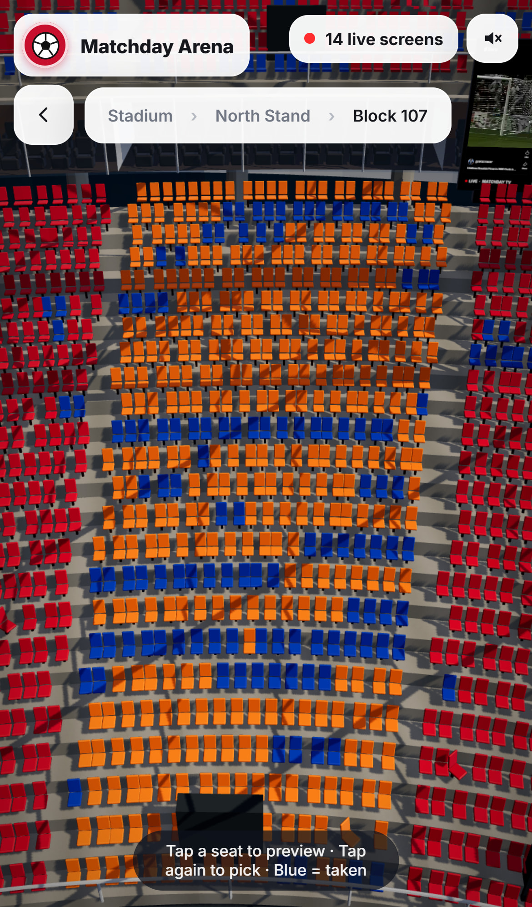
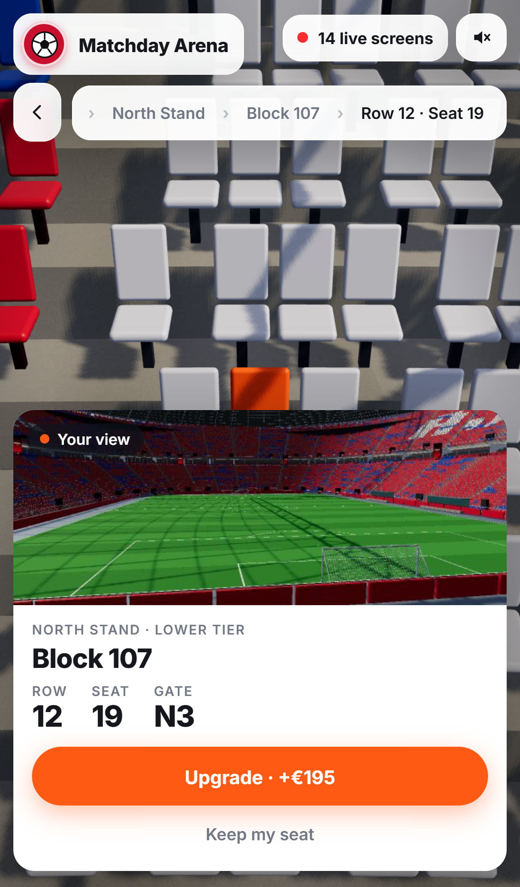
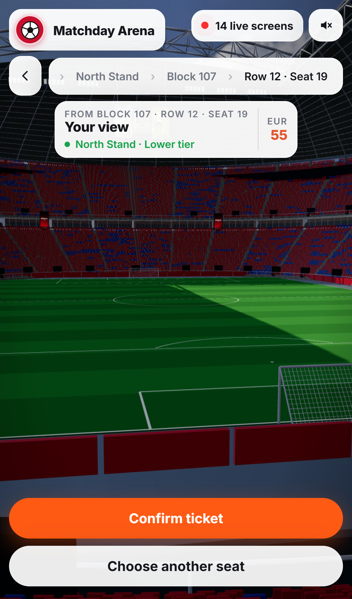

# Matchday Arena: 3D Stadium Seat Picker

A fully 3D, in-browser stadium where fans fly from an aerial view down to their exact seat. They see the real view from that seat before confirming a ticket. Live video screens play short football clips around the bowl, and the same experience runs on laptops and phones.

This repository is a **showcase only**. It holds screenshots, ready-to-paste prompts to recreate it, how it was made, and pseudocode.

| | |
|---|---|
| [Prompts](PROMPTS.md) | Step-by-step prompts to recreate it exactly |
| [How we made it](HOW-WE-MADE.md) | The build process, step by step |
| [Pseudocode](PSEUDOCODE.md) | How the app works, in plain pseudocode |

---

## Laptop

| Aerial view | Stand: hover a block for price |
|---|---|
|  |  |

| Block: pick a seat | Seat chosen: ticket with a preview of the view |
|---|---|
|  |  |

**View from the seat**

---

## Mobile

| Aerial | Stand | Block | Ticket | Your view |
|---|---|---|---|---|
|  |  |  |  |  |

---

### The flow

1. **Stadium**: an aerial orbit over the arena and its park. Hover or tap a stand to see availability.
2. **Stand**: fly into a stand. Every block shows its tier, price and seats left.
3. **Block**: zoom into a block. Blue seats are taken; free seats can be picked.
4. **Seat**: the chosen seat is highlighted, and a ticket appears with a rendered preview of the view from that seat. Fans can upgrade to a skybox or keep the seat.
5. **Your view**: the camera drops to eye level in that seat. Fans can look around and then confirm the ticket.
